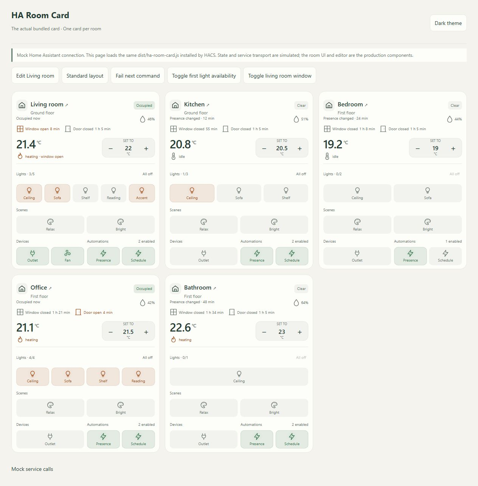

# HA Room Card

A compact, theme-native **Home Assistant dashboard card for one room**. Add one card per room to build a house overview. Version **0.2.0** includes the actual room interface and visual configuration editor in `dist/ha-room-card.js`; it replaces the entity-only starter from v0.1.0.



## Features

- Current and target temperature, ± controls, thermostat limits and reported step sizes. Default adjustment is 0.5 in the thermostat's unit; coarser native steps take precedence.
- One to five lights, illuminated state icons and an all-off action for included lights.
- Momentary scene activation, switch/input_boolean/fan controls, automation enable/disable.
- Window and door contacts with open/closed durations from `last_changed`, updated every 30 seconds.
- Humidity, occupancy and an optional last-activity timestamp entity. Without one, the card labels the presence transition accurately.
- Compact layout, optional captions, section visibility and per-entity inclusion/name/icon overrides.
- Room details with supported brightness sliders and links to HA's native entity details and real history.
- Authoritative HA state, pending feedback, duplicate-command protection, errors and unavailable states.

## Install / update with HACS

[](https://my.home-assistant.io/redirect/hacs_repository/?owner=jancrab&repository=ha-room-card&category=plugin)

1. In HACS, add `https://github.com/jancrab/ha-room-card` as a custom **Dashboard** repository.
2. Download/update **HA Room Card** to v0.2.0 or later.
3. Check the existing JavaScript module resource: `/hacsfiles/ha-room-card/ha-room-card.js`. Do not register the same card twice.
4. Reload the frontend; if the old entity-only card/editor persists, hard-refresh or clear the frontend cache. For manual module URLs, update their version query to `?v=0.2.0`.
5. Edit your dashboard, choose **Add card**, then search for **HA Room Card**. This is a dashboard card, not an integration or entity row.

Open the visual editor to select entities. Sections include Room & layout, Temperature & presence, Lights, Window & door contacts, Scenes, Devices and Automations. Under **Customize selected entities**, each selected item can be hidden or given its own label/icon. No YAML is required for normal configuration.

The original v0.1.0 `entity:` option migrates for supported entity domains, but it cannot discover your other room entities. Choose those explicitly in the new editor.

## Manual installation

Copy the release asset `ha-room-card.js` to `/config/www/ha-room-card.js`. Register `/local/ha-room-card.js?v=0.2.0` as a JavaScript **module** in dashboard Resources. On updates replace the file and change the query version on the existing resource.

## Example configuration

```yaml
type: custom:ha-room-card
name: Living room
icon: mdi:sofa-outline
compact: true
climate: climate.living_room
humidity: sensor.living_room_humidity
presence: binary_sensor.living_room_presence
windows:
  - entity: binary_sensor.balcony_window
    name: Balcony
doors:
  - binary_sensor.living_room_door
lights:
  - entity: light.living_room_ceiling
    name: Ceiling
    icon: mdi:ceiling-light-outline
  - entity: light.living_room_reading
    name: Reading
scenes:
  - entity: scene.living_room_relax
    name: Relax
devices:
  - switch.living_room_outlet
  - fan.living_room_purifier
automations:
  - entity: automation.living_room_presence
    name: Presence
  - entity: automation.living_room_heating
    name: Schedule
```

Every section is optional. Replace the example IDs with your own entities. Light groups count as one light.

| Option | Meaning / default |
| --- | --- |
| `name`, `subtitle`, `icon` | Room heading, optional subtitle and MDI icon. Name defaults to Room. |
| `compact` | Dense layout; `true`. |
| `show_labels` | Captions under icons; `true`. |
| `climate` | Climate entity for target/current temperature and HVAC action. |
| `temperature` | Optional temperature sensor overriding the current reading. |
| `temperature_step` | Requested adjustment step; `0.5`. Native step and bounds are respected. |
| `humidity` | Optional humidity sensor; otherwise climate `current_humidity` if reported. |
| `presence` | Binary occupancy/motion sensor. |
| `activity` | Optional timestamp sensor or date/time input_datetime for last activity. |
| `windows`, `doors` | Binary sensor lists; `on` means open. |
| `lights` | Up to five light entities. |
| `scenes` | Scene entities, activated through `scene.turn_on`. |
| `devices` | Switch, input_boolean and fan entities. |
| `automations` | Automation entities to enable/disable. |
| `show_thermostat`, `show_humidity`, `show_presence`, `show_contacts`, `show_lights`, `show_scenes`, `show_devices`, `show_automations` | Show/hide a section; all default to `true`. Empty sections disappear. |

List entries accept an entity ID or `{entity, name, icon, enabled}`. `enabled: false` excludes that entity from the interface and group actions. Hiding an entire section does not change the physical device state. Card configuration is stored by Home Assistant, not browser local storage.

## Runtime behavior and limits

- Setpoints use `climate.set_temperature`; the card does not change HVAC mode implicitly. Single-target controls require the device's supported feature. Range modes use native HA details instead of inventing a single target.
- Heating status comes from `hvac_action`, not a comparison of current and target temperatures. The card uses HA/entity units, including Fahrenheit.
- Lights, fans, switches and input booleans use their domain's `turn_on`/`turn_off` actions. Automation disabling uses `stop_actions: false`: running actions are allowed to finish.
- Scene icons briefly confirm activation and never claim a permanent on/off state.
- Light dimmers appear only when supported color modes indicate brightness support. Advanced color and device controls are available through native HA details.
- State is never fabricated after a command. Pending controls are locked until the call and device state are confirmed. A five-second state delay is reported as unconfirmed; a 15-second backend timeout has an uncertain outcome and should be checked before retrying.
- Contacts and sensors are read-only. Activity timestamps and `last_changed` require valid HA timestamps. Missing, unknown and unavailable entities are visible and cannot be switched.

## Validation and development

```sh
npm ci
npm run check
npm run dev
```

Open http://127.0.0.1:4173 (set `PORT` if occupied). **The canonical preview loads the real built bundle**, with explicitly mocked HA transport and form widgets. It exercises the same card and editor shipped to users. The older standalone visual prototype remains at `/demo/index.html` for design reference.

Tests cover configuration/migration, real service payloads, state confirmation, errors/timeouts, capabilities, contact times, reused HA state objects, subscription cleanup and the editor bootstrap. Browser QA covers the built card and editor on desktop/mobile. No physical-device or authenticated live Home Assistant verification has been performed in this workspace; mock tests do not establish integration-specific behavior.

MIT; see [LICENSE](LICENSE). Development guidance: [AGENTS.md](AGENTS.md) and [working guide](docs/working-guide.md).
